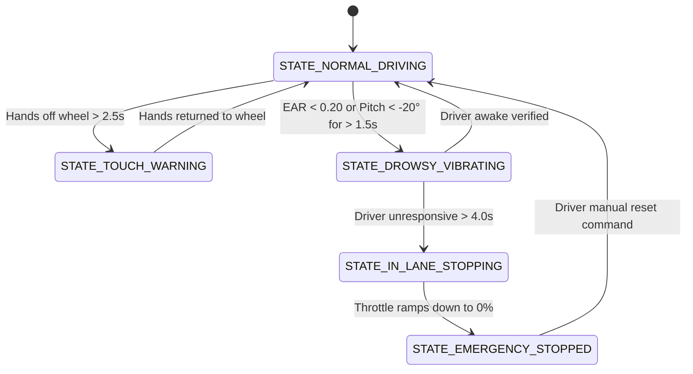

# 🚗 SafeSteer-ADAS (v1.0 - Core Safety & In-Lane Stop)

### Edge-AI Driver Monitoring & Closed-Loop In-Lane Emergency Assist

**A Hardware-in-the-Loop (HIL) ADAS prototype combining on-device computer vision with deterministic electronic Drive-by-Wire (DbW) throttle interlock.**

[Overview](#-overview) • [Core Features](#-core-features-v10) • [System Architecture](#-system-architecture) • [Wiring & BOM](#-hardware-bom--pinout) • [State Machine](#-finite-state-machine) • [Getting Started](#-getting-started) • [License](#-license)

## 📌 Overview

Driver fatigue and sudden medical incapacitation account for over 20% of severe road collisions. **SafeSteer-ADAS (v1.0)** focuses on establishing a rock-solid, fail-safe emergency intervention loop.

Instead of risky autonomous lane changes or premature cellular integrations, Version 1.0 implements an industry-standard **In-Lane Emergency Assist** (comparable to emergency stop systems found in modern production vehicles):

1. Continuously tracks driver alertness and physical hands-on-wheel presence.
2. Escalates warnings through driver seat haptics if micro-sleep or head-dropping is detected.
3. If the driver remains unresponsive, the system automatically activates hazard flashers and executes a controlled, safe electronic throttle ramp-down to $0$ within the current travel lane.

## ⚡ Core Features (v1.0)

* **Drive-by-Wire (DbW) Electronic Throttle:** Reads driver acceleration demand via an analog potentiometer with zero mechanical complexity or risk of gear binding.
* **Capacitive Touch Steering Interlock:** Uses high-sensitivity capacitive sensing to ensure the driver maintains contact with the wheel, cutting throttle if contact is lost beyond a 2.5s safety buffer.
* **Dual-Metric Edge AI Monitoring (Android):**
  * **Eye Aspect Ratio (EAR):** Tracks blink frequency and micro-sleep ($EAR < 0.20$ for $>1.5\text{ s}$).
  * **Head Pitch ($\theta_x$):** Flags sudden head-nodding/slumping ($\theta_x < -20^\circ$) indicative of falling asleep or fainting.
* **Pulsed Haptic Seat Alert:** Activates a 3V vibration motor through a flyback-protected NPN transistor driver to alert and awaken the driver.
* **Safe In-Lane Controlled Deceleration:** Gradually clamps motor drive/speed output to zero while pulsing hazard indicators at $2\text{ Hz}$ to signal trailing traffic.

## 🏗 System Architecture

```
                       +---------------------------------------+
                       |           ANDROID CLIENT              |
                       |  - CameraX Real-time Stream           |
                       |  - ML Kit On-Device Face Mesh         |
                       |  - Metrics: EAR + Head Pitch (θx)     |
                       |  - Real-time Driver State Evaluation  |
                       +-------------------+-------------------+
                                           |
                                           | Serial over USB-OTG / BLE (115200 baud)
                                           v
+----------------------------------------------------------------------------------+
|                         EMBEDDED CONTROLLER (ESP32 DevKit)                       |
|                                                                                  |
|  [Inputs]                                                                        |
|  ├── 10kΩ Potentiometer (ADC)     ──> Accelerator Demand (Drive-by-Wire)         |
|  └── TTP223 Capacitive Module     ──> Steering Wheel Hand Contact Status         |
|                                                                                  |
|  [Actuators & Indicators]                                                        |
|  ├── 2N2222 + 3V Coin Motor       ──> Pulsed Seat Haptic Alert (400ms on/off)    |
|  ├── Blue LED (PWM / Timer)       ──> Commanded Motor Throttle Output            |
|  └── Dual Yellow LEDs             ──> Emergency Hazard Blinkers                  |
+----------------------------------------------------------------------------------+
```

## 🔬 Mathematical Formulations

### 1. Eye Aspect Ratio (EAR)

Calculates eyelid separation relative to horizontal eye width:

$$\text{EAR} = \frac{\Vert\mathbf{p}_2 - \mathbf{p}_6\Vert + \Vert\mathbf{p}_3 - \mathbf{p}_5\Vert}{2 \cdot \Vert\mathbf{p}_1 - \mathbf{p}_4\Vert}$$

* **Awake Baseline:** $\text{EAR} \ge 0.25$
* **Drowsiness Trigger:** $\text{EAR} < 0.20 \quad \text{for } t > 1.5\text{ s}$

### 2. Head Pitch Angle ($\theta_x$)

Derived from 3D facial landmarker Euler decomposition:

$$\theta_x = \arctan2(R_{32}, R_{33}) \cdot \frac{180^\circ}{\pi}$$

* **Head-Drop Trigger:** $\theta_x < -20.0^\circ$

### 3. Electronic Throttle Arbitration

The vehicle speed output $V(t)$ arbitrates user demand against touch and attentiveness interlocks:

$$V(t) = T_{\text{demand}}(t) \cdot C_{\text{touch}}(t) \cdot A_{\text{driver}}(t)$$

## 🧰 Hardware BOM & Pinout

### Bill of Materials

| Component | Part/Model | Qty | Role |
| ----- | ----- | ----- | ----- |
| Microcontroller | ESP32 DevKit V1 (or Arduino Uno) | 1 | Master real-time safety arbiter |
| Throttle Input | 10kΩ Linear Potentiometer (B10K) | 1 | Accelerator pedal simulator |
| Touch Sensor | TTP223 Capacitive Touch Module | 1 | Steering wheel contact verification |
| Touch Surface | Conductive Adhesive Copper Foil Tape | 1 roll | Steering rim contact surface |
| Haptic Actuator | 1027/1030 3V DC Coin Vibration Motor | 1 | Seat haptic driver alert |
| Driver Circuit | 2N2222 NPN + 1kΩ Resistor + 1N4007 | 1 set | Flyback protection & motor switching |
| Speed Indicator | 1x Blue/Green 5mm LED + 220Ω | 1 set | Commanded vehicle speed indicator |
| Hazard Flashers | 2x Yellow 5mm LEDs + 220Ω | 1 set | Emergency hazard indicators |
| Mobile Link | USB-C to USB-A OTG Adapter | 1 | Low-latency serial bridge |

### ESP32 Pin Connections

```
[ESP32 GPIO 34 (ADC)] <--- Potentiometer Center Wiper (Throttle Demand)
[ESP32 GPIO 4       ] <--- TTP223 OUT (Capacitive Touch)
[ESP32 GPIO 18      ] ---> 1kΩ Resistor ---> 2N2222 Base (Vibration Motor)
[ESP32 GPIO 23 (PWM)] ---> 220Ω Resistor ---> Blue LED (Vehicle Speed)
[ESP32 GPIO 22      ] ---> 220Ω Resistor ---> Dual Yellow LEDs (Hazards)
```

## 🔄 Finite State Machine (v1.0)



## 🚀 Getting Started

### 1. ESP32 Firmware Setup

1. Open the Arduino IDE and select **ESP32 Dev Module**.
2. Flash the v1.0 firmware onto your ESP32.
3. Open the Serial Monitor at **115200 baud** to monitor state transitions and inject manual test commands (`D` for Drowsy, `A` for Awake, `R` for Reset).

### 2. Android Setup

1. Open the project in Android Studio.
2. Ensure Camera permission is granted in `AndroidManifest.xml` (no SMS or Telephony permissions required in v1.0).
3. Connect the phone to the ESP32 using the USB-OTG adapter.
4. Mount the phone at face level to start tracking eye state and head angle in real time.

## 🗺 Roadmap

* [x] **v1.0 (Current):** Potentiometer DbW throttle, capacitive wheel interlock, haptic seat warning, in-lane controlled emergency braking, and hazard indicator actuation.
* [ ] **v1.1:** Automated cellular telematics (GPS SMS & SOS auto-dialing upon verified emergency stop).
* [ ] **v2.0:** Electric Power Steering (EPS) servo integration, roadside ultrasonic curb detection, and microwave radar blind-spot checks for autonomous shoulder pullover.

## 📄 License

This project is licensed under the MIT License - see the [LICENSE](LICENSE) file for details.
